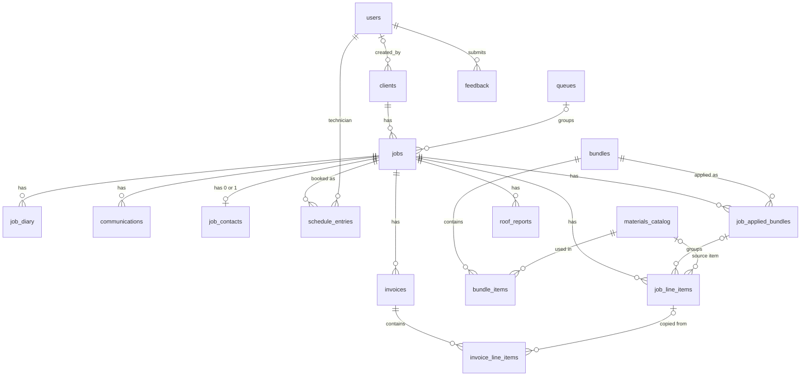

# Database Schema — How the Tables Connect

A plain-English map of the Zenith CRM database. Built from `supabase/schema/`, `supabase/policies/` and `supabase/migrations/` on 2026-10-30, and checked line by line against those files. Not checked against the live database.

**The one idea to remember:** almost everything hangs off a **job**. A client has jobs; each job has its billing lines, invoices, diary, messages, reports, and bookings.

---

## 1. The big picture

```
                         ┌──────────┐
                         │  users   │  (staff accounts: admin / office / technician)
                         └──────────┘
       linked from many tables as "who created / sent / updated this"

┌──────────┐  1 → many  ┌──────────┐  many → 1  ┌──────────┐
│ clients  │───────────▶│   jobs   │◀───────────│  queues  │  (optional folder)
└──────────┘            └────┬─────┘            └──────────┘
                             │ 1 → many (everything below belongs to one job)
   ┌───────────┬─────────────┼──────────────┬──────────────┬───────────┬─────────────────┐
   ▼           ▼             ▼              ▼              ▼           ▼                 ▼
job_diary  communications  job_contacts  schedule_entries  roof_reports  job_applied_bundles  invoices
                           (0 or 1)      (→ technician)                   │                  │
                                                                          │ groups           │ contains
                                                                          ▼                  ▼
                                                                    job_line_items ──copied──▶ invoice_line_items

PRICING LIBRARY (not tied to any job)
   bundles ──contains──▶ bundle_items ──points to──▶ materials_catalog
      │
      └── applying a bundle to a job creates a job_applied_bundles row

feedback: standalone (linked only to the user who sent it)
```

`job_line_items` belongs to a job directly. The link to `job_applied_bundles` is optional — one-off lines have none.

---

## 2. Diagram (renders on GitHub)



---

## 3. The tables, grouped

### People
| Table | What it holds | Links to |
|---|---|---|
| `users` | Staff accounts and their `role` (admin / office / technician) | Supabase login (`auth.users`) |
| `clients` | Customers: name, phone, email, address | — |

### Jobs (the centre)
| Table | What it holds | Links to |
|---|---|---|
| `jobs` | One job: number, status, description, site address | **client** (required), **queue** (optional) |
| `queues` | Folders like "To Quote" | — |
| `job_contacts` | An on-site contact for one job (tenant, foreman) | job — at most one per job |
| `job_diary` | Notes and photos on a job | job |
| `communications` | Email/SMS log (mocked) | job, sender (user) |
| `schedule_entries` | Bookings: which technician, which day, what time | job, technician (user) |
| `roof_reports` | Generated roof report `.docx` files | job |

### Pricing library (reusable, not tied to a job)
| Table | What it holds | Links to |
|---|---|---|
| `materials_catalog` | Every material/service and its cost and price | — |
| `bundles` | Job templates, e.g. "Concrete Roof Restoration" | — |
| `bundle_items` | The lines inside a bundle: which catalog item, default qty, default markup | bundle, catalog item (live link — no copied price) |

### Billing a job
| Table | What it holds | Links to |
|---|---|---|
| `job_applied_bundles` | "Bundle X was added to Job Y" — one row each time | job, bundle |
| `job_line_items` | The job's actual billing lines | job, applied bundle (optional), catalog item (optional) |
| `invoices` | An invoice for a job (a job can have several) | job |
| `invoice_line_items` | The lines frozen onto an invoice | invoice, source job line (optional) |

### Other
| Table | What it holds | Links to |
|---|---|---|
| `feedback` | Staff feedback messages + photos | the user who sent it |

---

## 4. How billing data flows

```
materials_catalog ◀──live link── bundle_items
        │                              │
        └──────────┬───────────────────┘
                   │ copied when the bundle is applied
                   ▼
            job_line_items ──copied when invoiced──▶ invoice_line_items
          (this job's line)                          (frozen on invoice)
```

1. Staff build a **bundle** from catalog items. A bundle line only points at the catalog item; it stores no price of its own.
2. Applying the bundle to a job creates one `job_applied_bundles` row, plus one `job_line_items` row per bundle line. At that moment the catalog item's code, name and **purchase cost** are copied onto the job line, along with the bundle's default qty and markup.
3. Staff can edit those job lines freely, or add one-off lines.
4. Creating an invoice copies the chosen job lines into `invoice_line_items`. The invoice never changes after that.

**What this means:** changing a catalog price updates every bundle straight away, but never changes a job that already has the lines, or any invoice.

---

## 5. What happens when something is deleted

| If you delete… | What happens |
|---|---|
| A **job** | Its diary, messages, job contact, bookings, line items, applied bundles, and roof reports are deleted too. **Blocked if it has invoices.** |
| A **client** | **Blocked** if they have any jobs. |
| A **bundle** | Its bundle items go too. **Blocked** while it's applied to any job. |
| A **catalog item** | **Blocked** if any bundle or job line uses it. (Normally archived instead.) |
| An **applied bundle** on a job | Only that bundle's job lines are removed. Other lines stay. |
| A **queue** | Jobs stay; they just become "unqueued". |
| A **job line item** | Invoices keep their copy; the link back is cleared. |
| A **user** | **Blocked** if they created or are booked on anything (jobs, clients, bookings, feedback, etc.). |
| An **invoice** or **roof report** | No delete button in the app, and office can't. Admin's database rules (`for all`) do technically allow it. Deleting an invoice also removes its invoice lines. |

Catalog items and bundles use an `active` flag (archive) rather than being deleted.

**Who can delete:** admin can delete anything the rules above allow. Office can only delete routine items: bundle lines, job lines, applied bundles, job contacts, bookings and queues. Technicians can't delete anything.

---

## 6. Who can see what (short version)

- **Admin / office:** can see everything, except `feedback`, which only admin can read. Office can see all staff accounts.
- **Technician:** only jobs where they have a **confirmed** booking in `schedule_entries` (tentative bookings don't count). On those jobs they can:
  - **see and add:** diary entries (with photos) and SMS
  - **see only:** job details, the job contact, the client's details, their own confirmed bookings, and line items as **qty + name only** (no cost/price)
  - no access to email, invoices, catalog, bundles, queues or roof reports
  - they can see only their own `users` row, and can send feedback but not read it back

Full detail lives in `supabase/policies/` and `CLAUDE.md`.

---

## 7. Status and type values

| Field | Allowed values |
|---|---|
| `jobs.status` | Quote → Work Order → Scheduled → Completed |
| `users.role` | admin, office, technician |
| `communications.type` / `direction` | email, sms / outbound, inbound |
| `schedule_entries.entry_type` / `status` | inspection, work / tentative, confirmed |
| `roof_reports.roof_type` | Tiled Roof, Metal Roof, Asbestos Roof, Others |

---

## Note: leftover column

`jobs.invoiced` (true/false) is still in the table. `useJob.js` still fetches it, but no screen shows it — invoices now live in the `invoices` table. A candidate for a future cleanup (remove it from `useJob.js` first).
